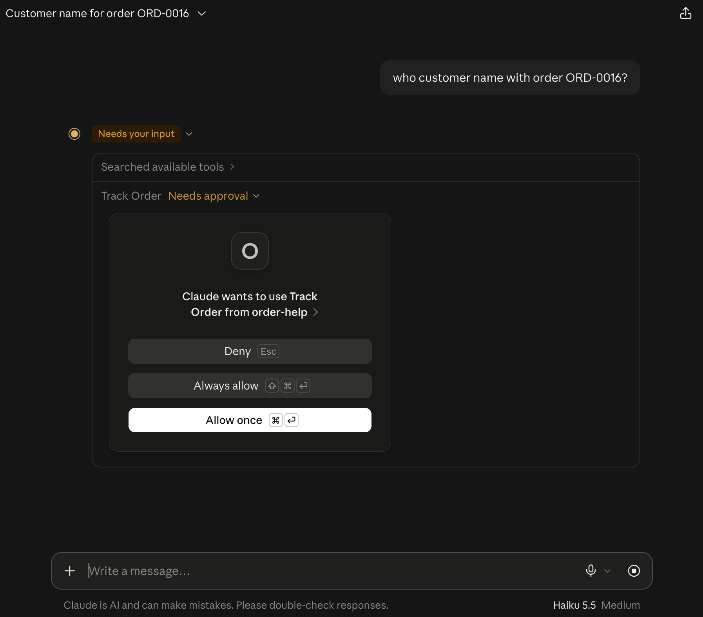
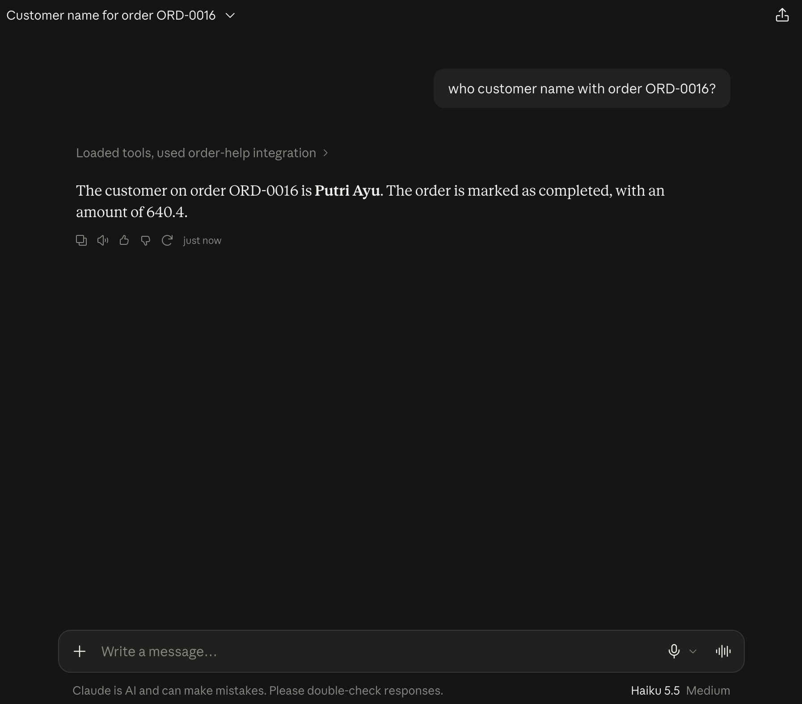
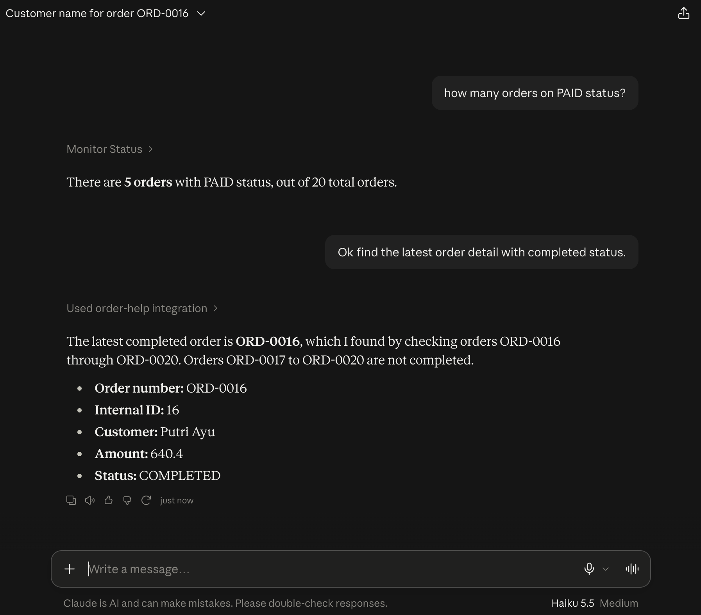

# SAMPLE MCP 001 — FastMCP Order Service Lab

A small [Model Context Protocol](https://modelcontextprotocol.io) server built with
[FastMCP](https://gofastmcp.com) that exposes a dummy order dataset through callable tools.

The project separates business logic from transport concerns: `order_service.py` contains plain
Python functions, and `mcp_server.py` registers them as MCP tools through thin wrappers.

## Tools

| Tool | Parameter | Description |
| --- | --- | --- |
| `greet` | `name: str` | Returns a greeting. |
| `track_order` | `order_no: str` | Returns the full detail of a single order. |
| `monitor_status` | `status: str` | Returns how many orders are currently in the given status. |

Valid statuses are `PENDING`, `PAID`, `SHIPPED`, `COMPLETED`, and `CANCEL`.
Both tools normalize input to uppercase, so `paid` and `PAID` behave identically.

## Demo

Screenshots from Claude Desktop connected to this server as the `order-help` integration.

### Tool approval

Claude asks for permission before calling `track_order`.



### Looking up a single order

Prompt: `who customer name with order ORD-0016?`



### Counting orders by status

Prompt: `how many orders on PAID status?` followed by
`Ok find the latest order detail with completed status.`



## Project structure

```
mcp01/
├── src/mcp01/
│   ├── __init__.py       # Package entry point
│   ├── models.py         # OrderStatus enum and Order (Pydantic) model
│   ├── dummy_data.py     # 20 sample orders (ORD-0001 .. ORD-0020)
│   ├── order_service.py  # Business logic: track_order, monitor_status
│   └── mcp_server.py     # FastMCP instance and tool registration
├── pyproject.toml
└── uv.lock
```

## Requirements

- Python 3.11 or newer
- [uv](https://docs.astral.sh/uv/)

## Setup

```bash
cd mcp01
uv sync
```

## Running the server

All commands must run inside the project environment. Using `uv run` guarantees the virtual
environment from `.venv`, where the `mcp01` package is installed.

### STDIO (default)

```bash
uv run fastmcp run src/mcp01/mcp_server.py:mcp
```

Because `mcp_server.py` calls `mcp.run()` under `__main__`, this is equivalent:

```bash
uv run python src/mcp01/mcp_server.py
```

With STDIO there is no port or URL; the client spawns the process and communicates over
stdin/stdout. Running it directly in a terminal just waits silently for input.

### HTTP

```bash
uv run fastmcp run src/mcp01/mcp_server.py:mcp --transport http --port 8000
```

The endpoint is `http://127.0.0.1:8000/mcp`. Add `--no-banner` to keep the output clean, or
`--reload` to restart automatically on file changes.

## Connecting an MCP client

Clients launch the server themselves, so they need absolute paths:

```json
{
  "mcpServers": {
    "mcp01": {
      "command": "uv",
      "args": [
        "run",
        "--directory",
        "[YOUR-DIRECTORY]",
        "fastmcp",
        "run",
        "src/mcp01/mcp_server.py:mcp"
      ]
    }
  }
}
```

Alternatively, call the virtual environment binary directly:

```json
{
  "mcpServers": {
    "mcp01": {
      "command": "/[YOUR-DIRECTOPRY]/.venv/bin/fastmcp",
      "args": [
        "run",
        "/[YOUR-DIRECTORY]/src/mcp01/mcp_server.py:mcp"
      ]
    }
  }
}
```

## Tool reference

### `track_order`

```text
track_order(order_no="ORD-0007")
```

```json
{
  "found": true,
  "order": {
    "id": 7,
    "order_no": "ORD-0007",
    "amount": 1899.99,
    "customer": "Gita Permata",
    "status": "PAID"
  }
}
```

Unknown order numbers return `{"found": false, "order_no": ..., "message": ...}` instead of an
error.

### `monitor_status`

```text
monitor_status(status="SHIPPED")
```

```json
{
  "status": "SHIPPED",
  "count": 4,
  "total_orders": 20
}
```

Invalid values return a count of `0` plus the list of allowed statuses.

### `greet`

```text
greet(name="World")
```

```text
Hello World!
```

## Sample data

`dummy_data.py` holds 20 orders with the fields `id`, `order_no`, `amount`, `customer`, and
`status`. The status distribution is:

| Status | Count |
| --- | --- |
| PENDING | 4 |
| PAID | 5 |
| SHIPPED | 4 |
| COMPLETED | 5 |
| CANCEL | 2 |

The data is a static in-memory list; nothing is persisted between runs.

## Calling tools from Python

The in-memory transport connects to the server object without spawning a process:

```python
import asyncio

from fastmcp import Client
from mcp01.mcp_server import mcp


async def main() -> None:
    async with Client(mcp) as client:
        result = await client.call_tool("track_order", {"order_no": "ORD-0003"})
        print(result.data)


asyncio.run(main())
```

## Troubleshooting

**`ModuleNotFoundError: No module named 'mcp01'`**

The command ran the globally installed FastMCP instead of the project environment. Confirm with:

```bash
which fastmcp           # global install
uv run which fastmcp    # must point into mcp01/.venv/bin
```

Use `uv run fastmcp ...`, or activate the environment first:

```bash
source .venv/bin/activate
```

**Tools are not visible in a client**

Point the client at the absolute script path and confirm the JSON key is `mcpServers`. For HTTP,
make sure the server is running and the URL ends with `/mcp`.

## Notes

- The `mcp01` console script declared in `pyproject.toml` is a placeholder that prints a message;
  the server is started through the `fastmcp` CLI as shown above.
- Tool registration lives in `mcp_server.py`; keep service logic in dedicated modules so it
  remains testable without an MCP client.

